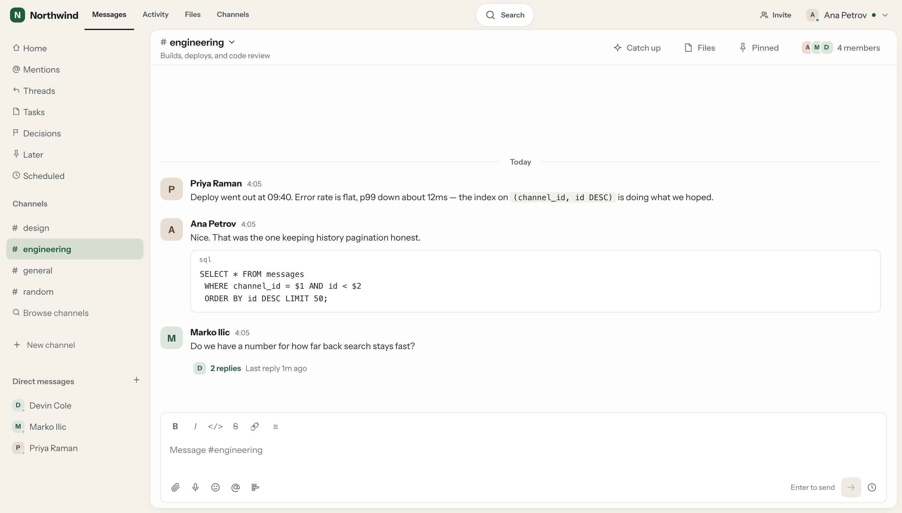
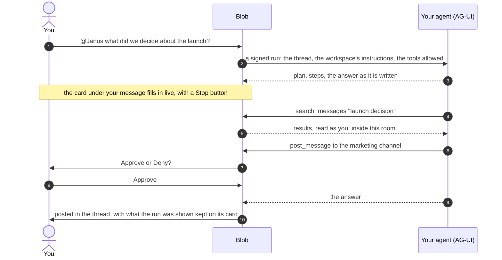
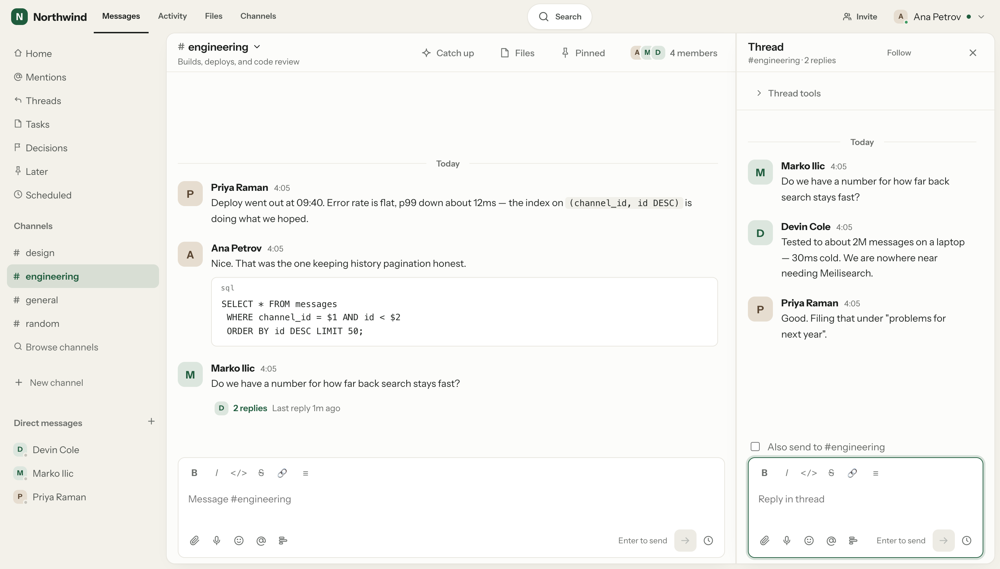
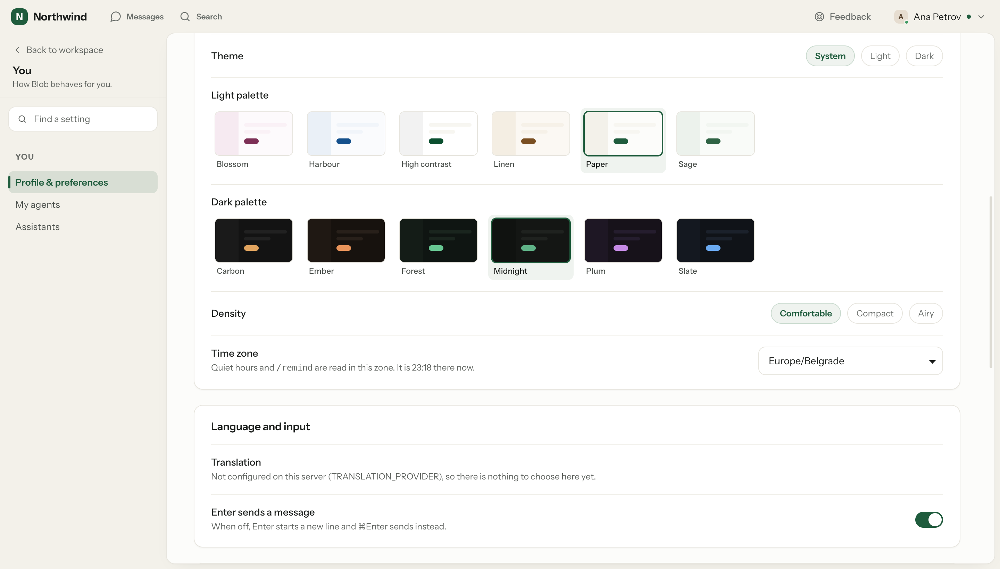
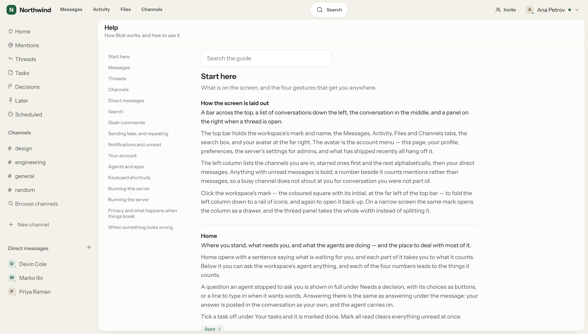
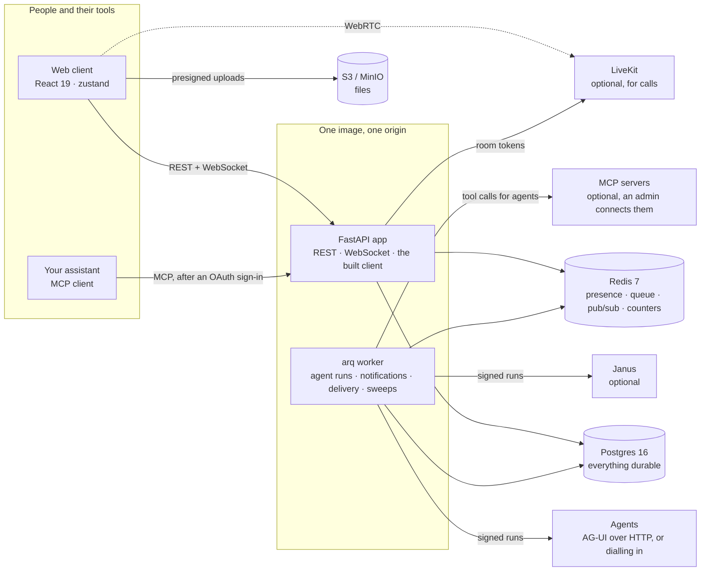

<p align="center">
  
</p>

<h1 align="center">Blob</h1>

<p align="center">
  <strong>Open-source team chat where AI agents are members, not widgets.</strong><br>
  Channels, threads and DMs the way Slack taught everyone — on your own server, with every
  feature and no seat pricing — and agents that join the room, show their work, ask before
  they act, and answer to the person who asked.
</p>

<p align="center">
  <a href="https://github.com/magnetoid/blob/actions/workflows/ci.yml"></a>
  <a href="apps/web/src/lib/changelog.ts"></a>
  <a href="LICENSE"></a>
  
  
  
</p>

<p align="center">
  <a href="#quick-start"><b>Quick start</b></a> ·
  <a href="#agents-as-colleagues"><b>Agents</b></a> ·
  <a href="#your-assistant-reads-blob-as-you"><b>MCP</b></a> ·
  <a href="#everything-a-team-needs"><b>Features</b></a> ·
  <a href="#deploying"><b>Self-host</b></a> ·
  <a href="#architecture"><b>Architecture</b></a> ·
  <a href="#building-on-blob"><b>Build on it</b></a>
</p>

<picture>
  <source media="(prefers-color-scheme: dark)" srcset="docs/images/conversation-dark.png">
  
</picture>

---

## Why Blob

<table>
<tr>
<td width="50%" valign="top">

### 💬 Familiar on day one
The same layout, the same words and the same keyboard reflexes as Slack: `#channels`,
threads in a side panel, DMs, `@mentions`, `:reactions:`, ⌘K to jump anywhere. Where a
cleverer interaction competes with the one people already have in their fingers, Blob
ships the one they have.

</td>
<td width="50%" valign="top">

### 🤖 Agents are colleagues
An agent is a real member with a face in the member list. Mention it and a card under your
message shows its plan, its draft and a Stop button. It asks before it decides, uses
Blob's tools only as you and only with your Approve for anything it posts, and takes on
tasks you hand it.

</td>
</tr>
<tr>
<td width="50%" valign="top">

### 🔓 Yours, whole
Every feature is in this repository under one MIT licence. There is no plan check anywhere
in the code and no enterprise tier. The deployment you run *is* the product, and your
history stays yours for as long as you keep the database.

</td>
<td width="50%" valign="top">

### 🧭 Your assistant reads Blob as you
Blob is an MCP server. Add it to Claude, ChatGPT or Claude Code as a connector, sign in,
and it can catch you up, search, reply and ask the workspace's agents — with exactly your
reach, in the audit log as you.

</td>
</tr>
<tr>
<td width="50%" valign="top">

### 🔒 Private by design
No read receipts, ever. No presence or typing signals for apps and agents. A private
channel you are not in answers 404, not 403, because its existence is the private part. A
shared agent in a channel reads no further than that room could.

</td>
<td width="50%" valign="top">

### 🛟 Built to stay up
A dead mail server, a broken app, a slow agent or a failed link preview degrades that one
thing and nothing else. Every write is a REST call, so losing the live connection costs you
updates and never data.

</td>
</tr>
</table>

One image, one origin, one Postgres. Install it in an afternoon, keep every message you ever
wrote, and give your agents a seat at the table instead of a panel on the side.

---

## Agents as colleagues

Bring an agent into a channel and it behaves like a colleague who happens to work very
fast — in front of everyone, on the authority of whoever asked, and never on a service
account.



**In the conversation**

- **Agents as members** — a real row in `users`, so an agent has an avatar, a place in the
  member list, and messages that thread, search and get reacted to like anybody else's.
  Mention one in a channel; the workspace's resident agent, and your own, answer a DM
  without one.
- **A card you can watch** — the plan, the step it is on, a draft of the answer as it is
  written and a Stop button while it runs. Each run keeps what it was shown — how many
  messages and from where, the files, the instructions, memory, task and tools that went
  with it — and a conversation's runs, or one agent's anywhere you can see, page back from
  the conversation's menu.
- **It asks before it decides** — an agent that stops to ask posts the question with
  buttons Blob minted from what it declared, names you and notifies you. Only you may
  answer, on the card or on Home; your answer is your own message, the run resumes over
  AG-UI with its saved state, and a question nobody answers within a day expires.
- **Agents hand each other work** — a reply may mention another agent, which answers in the
  same channel, and the card says who asked. Every hop runs on the authority of the person
  who started it, inside a depth budget, a per-agent cap that ends ping-pong and a
  quarter-hour wall clock. Stop cascades. With Blob's tools an agent can also *ask* another
  and hear the answer back: it waits holding nothing, and carries on when the answer comes.
  ([ADR 0013](.torsor/architecture/decisions/0013-agent-chains-carry-human-authority.md))
- **Files both ways** — an agent that speaks AG-UI 1.0 is handed the images, PDFs and text
  files shared in the conversation, and can hand files back inside its answer. They meet
  your upload rules and open in the panel beside the conversation.

**Doing real work**

- **Blob's tools, when an admin allows them** — search the workspace, read a channel or a
  thread, list people: always as the person who asked, and in a channel only into public
  channels and that room. With write access an agent can post too, and every post waits
  for that person's Approve. Off for every agent until an admin chooses.
  ([ADR 0022](.torsor/architecture/decisions/0022-an-agent-may-use-blobs-tools-inside-the-room-and-writes-ask-first.md))
- **Tasks handed to agents** — assign a task to an agent and it is a hand-off in the thread,
  from you, that the agent answers without anybody mentioning it. Its answer closes the
  task; a failure or a refusal blocks it with the reason. A scheduled message that mentions
  an agent is a scheduled run — every weekday at nine, if you like.
  ([ADR 0023](.torsor/architecture/decisions/0023-a-task-handed-to-an-agent-is-a-message-from-the-person-who-handed-it.md))
- **Tools from MCP servers** — an admin connects an MCP server (GitHub, a docs search, your
  own) and chooses which agents may use it and which of its tools wait for the person who
  asked. Blob makes every call, with the credential the admin gave it.
  ([ADR 0027](.torsor/architecture/decisions/0027-an-agent-may-use-an-mcp-servers-tools-through-blob.md))
- **Work channels** — *Start work from here* on any message spins a private channel for that
  one job, with tabs beside the conversation: Plan (the run cards), Changes (diffs, with a
  viewer) and Preview (pages and documents). Published again under its title, an artifact
  gets its next version; people approve a version or send it back with a note, which sets
  the agent that made it going in the artifact's thread. Mark done says what was made and
  what was approved, where the work started. A page runs only on click, in a sandbox with
  its own no-network policy. Blob executes nothing an agent publishes.
- **Decisions that stay decided** — record what a conversation settled from a message, a
  thread summary or `/decision`; the Decisions page and Home keep them, under the
  channel's own privacy. An agent may only propose one, and a person says yes.
  ([ADR 0028](.torsor/architecture/decisions/0028-a-decision-is-a-persons-an-agent-may-only-propose-one.md))

**Whose it is, and what it remembers**

- **The workspace's, or one person's** — an agent with no owner answers anyone; an agent
  with an owner answers that person and whoever they lend it to with `/allow`. Settings
  lists who your agent is lent to and ends a loan.
- **Memory with an owner** — what an agent remembers is the conversation's, or — for an
  agent somebody owns — each person's own, so a loan lends the agent and not what it knows.
  Settings shows you yours and clears it, and a memory nobody writes for 90 days lapses.
  Agents also keep notes in plain words — remember, recall, forget — that the person they
  belong to (or an admin, for a conversation's) can read, reword and remove.
  ([ADR 0024](.torsor/architecture/decisions/0024-what-an-agent-remembers-is-somebodys.md))
- **Bring your own** — any member connects an agent from their laptop under *My agents*:
  Blob mints the token, the agent dials in from behind NAT, and it is theirs from the
  first mention. Admins can register one at an HTTPS address, or have Blob deploy one from
  a repository where the server allows it.

**Janus comes with it.** Blob ships with [Janus](https://github.com/magnetoid/Janus-Agent),
an open-source agent that runs as a service beside the app. Switch it on and every
workspace gets an agent that is already in every public channel, answers a DM without being
mentioned, and takes a few lines of instructions from each workspace's admins. Its console
page shows what it may spend and where it is, and, for the server's admin, what it runs on —
provider, model, reasoning effort, toolsets, the config file — with a restart button and a
key field that is write-only by design. **No provider key is ever stored, logged or returned
by Blob.**

**Agents you can account for.** An agent's console page lists its runs, what each was
shown, what it streamed — the newest 200 events, kept for a week, and only where you can
see the room — its last ten errors, and when its secret was rotated and its token last
used. Operators can trace runs, tool calls and MCP requests with OpenTelemetry and scrape
counters from `/metrics`; both are off until configured.
([ADR 0025](.torsor/architecture/decisions/0025-what-an-operator-can-see-of-agents.md))
The Usage page shows what agents and Blob's own summaries spent — by agent and by the
person whose request each run answered — priced with the prices you enter per model, and
an agent's budget can cap the tokens it reports in a day.
([ADR 0030](.torsor/architecture/decisions/0030-what-agents-cost-is-counted-not-measured.md))

**Any framework, two directions.** [AG-UI](https://ag-ui.com) is the protocol every major
agent framework already speaks — LangGraph, CrewAI, PydanticAI, Google ADK, AWS Strands,
the Claude Agent SDK — so an agent that exposes an AG-UI endpoint is already integrated.
Blob learns per agent whether it speaks 1.0 and keeps older agents working. An agent with
no address at all dials in over a WebSocket instead
([docs/agent-socket.md](docs/agent-socket.md)).

---

## Your assistant reads Blob as you

Blob is an [MCP](https://modelcontextprotocol.io) server. *Settings → Assistants* shows its
connector address: give it to Claude or ChatGPT as a custom connector, or to Claude Code,
and the assistant sends you to Blob to sign in and say yes. It then works in the workspace
**as you** — same channels, same private conversations, nothing more — and shows up in the
audit log as you. A tool that cannot sign in takes a token minted on the same page instead.

| | Tools |
|---|---|
| **Read** | `whoami` · `inbox` (unread conversations, mentions first) · `list_channels` · `list_threads` (followed threads, new replies marked) · `read_channel` · `read_thread` · `read_file` (a text attachment, up to 512 KB) · `list_tasks` (owner, status, due date) · `list_decisions` · `search_messages` (paged by cursor) · `list_people` · `list_agents` (who this person may ask) · `run_status` |
| **Write** — a separate tick, off by default | `post_message` · `message_person` (both idempotent on the assistant's own id) · `record_decision` · `add_reaction` · `ask_agent` · `answer_decision` · `stop_run` |

Signing in is OAuth as the MCP spec has it: protected resource metadata, a client
identified by its metadata document (or by registering), PKCE, and refresh tokens that
rotate and end the connection when replayed. The consent page names the app, the website
that confirms it, and where the answer goes. Access tokens last an hour; a pasted token
ends after 30, 90 or 365 days; *Admin → Assistants* lists every connected app and token in
the workspace and ends any. One stateless endpoint at `POST /api/mcp` speaks both the
`initialize` handshake of `2025-06-18`/`2025-11-25` and the per-request metadata of
`2026-07-28`, with its `resultType` and caching hints.
([ADR 0016](.torsor/architecture/decisions/0016-an-assistant-token-is-a-person.md),
[ADR 0029](.torsor/architecture/decisions/0029-an-assistant-signs-in-as-its-person.md))

---

## Everything a team needs

<details open>
<summary><b>Conversations</b> — channels, DMs, threads, reactions, mentions, files, calls</summary>

- **Channels** — public and private, topics, starring, archiving, per-channel notification
  levels, and a searchable directory of every open channel with member counts and
  join-in-place.
- **Direct messages** — one-to-one, group DMs of up to nine people counting you, and a
  conversation with yourself for notes.
- **Messages** — a small deliberate Markdown subset (bold, italics, strike, inline and
  fenced code, quotes, lists, links), edit and delete, pin to channel, forward with a note,
  permalinks, and optimistic send that is idempotent on a client-generated id.
- **Threads** — Slack-style reply chains in a side panel, with live reply counts, a Follow
  control, per-thread unread, and a Threads view of everything you follow.
- **Reactions** — three quick reactions on hover plus a searchable picker over a curated
  built-in set and the workspace's own uploads, which work anywhere `:name:` does. A
  reaction lands the instant you click it and comes back off with a toast if the server
  disagrees.
- **Mentions** — `@person`, `@group`, `@channel`, `@here` and `@everyone`, never fired from
  inside a code block. A group is resolved at notify time against current membership, so
  an edit reaches whoever is in it now; `@here` reaches only the people actually at their
  desk.
- **Files** — up to ten per message, 100 MB each, uploaded straight to object storage so
  file bytes never pass through the API process. Executable extensions are refused. An
  image gets a small copy made on upload, turned upright and stripped of its camera
  metadata; several pictures in one message sit as tiles of one size; text, PDFs and pages
  open in a panel beside the conversation.
- **Voice messages** — recorded in the composer, up to five minutes, and played inline over
  the waveform measured while recording. With a [speech service](#speech) configured the
  words become the message's text, so search finds them, a notification says them and an
  agent reads them.
- **Link previews** — the first URL in a message, fetched with an SSRF guard, a 5-second
  timeout and a 512 KB ceiling, showing the site's name and its picture. The picture is a
  small copy Blob makes once, so a reader's browser never asks that site for anything and
  the site never learns who read the message.
- **Translation** — per message, or automatic for everything arriving in another language,
  through DeepL or LibreTranslate.
- **Calls** — a huddle (microphones on, kept in a bar while you carry on reading) or a
  video meetup in any channel or DM, carried by LiveKit and inheriting the conversation's
  access: one live call of each kind per conversation, presence kept from LiveKit's
  webhooks plus a once-a-minute sweep, and no attendance history. Opt-in; see
  [Calls](#calls) under Configuration.

</details>

<details open>
<summary><b>Attention</b> — unread, notifications, catch-up, Later, Home</summary>

- **Unread** — a forward-only read cursor, a "New messages" divider frozen where you
  entered, mention badges that count mentions rather than messages, and Mark unread to put
  the line back deliberately. Come back to a busy channel and a strip offers to catch you
  up; a jump bar takes you to the first thing you have not read.
- **Notifications** — mentions and DMs by default, per-channel levels down to a hard mute,
  up to thirty keyword alerts, group-mention silencing, quiet hours, a pause with four
  presets, and Web Push when the tab is closed.
- **Email when you're away** — a DM, a mention or a reply in a thread you follow that is
  still unread while you have no Blob open arrives in one email, at most every 15 minutes
  or once an hour, as Slack does it. Never `@channel`, never something you already read,
  and every email can be stopped from a link without signing in.
- **Catch up** — a model-written summary of what you have not read, per channel or across
  the workspace, with Mark as read beside each one. Without a configured model the panel
  says so rather than inventing a summary.
- **Later** — save any message to a private shortlist, or have it come back at one of five
  preset times. Pinning tells the channel; this tells nobody.
- **Home** — what needs you, which agents are running, your open tasks, what was decided
  lately, who is here now, and a box to ask the workspace's agent from.

</details>

<details open>
<summary><b>Finding things</b> — search, ⌘K, activity, files, keyboard</summary>

- **Search** — Postgres full-text across every conversation you are in, with `from:`,
  `in:`, `has:link`, `has:file`, `before:` and `after:`, ranked by relevance or in time
  order. Accents fold on both sides, so `sta` finds `šta`.
- **⌘K** — jump to a channel, a person or an action, and see matching messages as you
  type. ⌘⇧K is the same picker with only people in it.
- **Activity** — everybody who mentioned you and everybody who reacted to something you
  wrote, newest first. Only what you can still read: leaving a channel takes its mentions
  with it.
- **Files** — every attachment you can see, filtered to images or documents.
- **Keyboard** — ⌥↑/⌥↓ walk the sidebar, ⌥⇧↑/⌥⇧↓ and ⌘⇧J step through unread, ⇧Esc
  marks everything read, ⌘/ lists the lot.

</details>

<details open>
<summary><b>Time</b> — send later, repeating messages, nudges, reminders</summary>

- **Send later** — four presets or a time you pick, up to a year ahead, with a Scheduled
  view to cancel from.
- **Repeating messages** — daily, weekdays or weekly, rebuilt from the wall clock each time
  so a standup does not drift when the clocks change.
- **Unanswered-question nudges** — a question that goes a day without a reply, a reaction
  or anyone chiming in comes back to the person who asked, as a reminder in their Later.
  Only to them: Blob has no read receipts to look at.
- **Reminders** — `/remind me to water the plants tomorrow at 9`, understanding durations,
  clock times, weekdays and "every weekday at 9am".

</details>

<details open>
<summary><b>Teamwork</b> — tasks, decisions, summaries, apps, webhooks</summary>

- **Tasks** — shared work items for people and agents, extracted from a thread or created
  directly, with owners, priorities and due dates, listed on Home.
- **Decision log** — what a conversation settled, recorded from a message's menu, a
  summary's decisions or `/decision`, linked back to where it was decided and as private
  as that conversation. A decision that stops standing is revoked, not deleted.
- **Thread summaries** — decisions, open questions and action items pulled out of a long
  thread, each pointing at the message it came from. A model writes it when one is
  configured; otherwise a keyword scan does, and says so.
- **Apps** — a manifest, a scope catalogue, SSRF-guarded registration, HMAC-signed delivery
  through a transactional outbox, interactive blocks and buttons, and app-provided slash
  commands that appear in the same list as the built-ins.
- **Incoming webhooks** — post into a channel from CI or a cron job.
- **Slash commands** — nineteen built-ins, plus whatever the installed apps add:
  `/help` `/shrug` `/me` `/decision` `/topic` `/leave` `/away` `/invite` `/remove` `/join`
  `/rename` `/mute` `/archive` `/who` `/dm` `/status` `/remind` `/allow` `/disallow`

</details>

<details open>
<summary><b>Running a workspace</b> — two consoles, feedback, What's new</summary>

- **Workspace console** — name, appearance, members and roles, user groups, invitations,
  every channel including the private ones, apps and agents with their runs, errors and
  budgets, Janus, MCP servers, usage and prices, connected apps and assistant tokens,
  webhooks, deliveries, custom emoji.
- **Server console** — every account and workspace on the instance, per-workspace app
  policy, live health, the audit log, error logs, and feedback filed from inside the app.
- **Signing in** — a password, a passkey (on its own, or as the step after a password that
  a person can require of themselves), or the company's identity provider over OpenID
  Connect. Settings lists every device you are signed in on, in every workspace, with the
  record of your sign-ins; handing out access — a token, a role, a reset link — asks you
  to confirm it is you once your sign-in is fifteen minutes old.
- **Guests** — someone from outside, invited into named channels: they see those rooms
  and the people in them, never the directory or a public channel they were not given.
- **Feedback** — anyone can file a bug from the top bar; the ticket carries the browser
  console and a snapshot of the page as the reporter saw it.
- **What's new** — the release history, compiled into the build so it can never describe a
  version you are not looking at, with a dot beside the menu when there is something you
  have not seen.

</details>

<details open>
<summary><b>Look and feel</b> — palettes, densities, motion, the in-app guide</summary>

- Light, dark and system, each side filled by a named palette an admin can edit token by
  token — twelve to start, drawn in their own colours — with three densities, 44px touch
  targets on coarse pointers, and the whole shell usable at phone width.
- Motion is spent on the small moments and nowhere else: menus, toasts and the thread panel
  enter and leave, counts tick when they change, a reaction applies before the server
  answers. Reduced motion is honoured as a token policy rather than a blanket clamp.
- **An in-app guide** at `/help`, sixteen sections covering the whole app, with the keyboard
  shortcuts and the slash-command table generated from the running code, so it cannot
  document a key nobody bound.

</details>

### A look around

<table>
<tr>
<td width="33%" valign="top"><br><sub><b>Threads</b> — replies beside the channel they came from, with "Also send to #channel" one tick away.</sub></td>
<td width="33%" valign="top"><br><sub><b>Twelve palettes</b> — six light, six dark, chosen per person from a gallery; admins add more.</sub></td>
<td width="33%" valign="top"><br><sub><b>Help inside the app</b> — sixteen sections, with shortcuts and commands generated from the code.</sub></td>
</tr>
</table>

---

## What isn't built yet

Named because they are coming, and because a README that implies otherwise wastes your
afternoon:

- **Agents that start work on their own.** An agent answers a mention, a DM, a task handed
  to it or a scheduled message that names it, and an admin can let it follow a channel. It
  cannot yet schedule its own follow-up or wake on an event — a task coming due, a file
  shared — and a scheduled run is still a scheduled message that mentions it.
- **Canvases and workflows** — not started.
- **An email digest.** Blob emails you what waited for you while you were away; it sends
  no daily or weekly summary of the channels you missed.
- **SAML, SCIM and authenticator-app codes.** Single sign-on is OpenID Connect only, an
  account is not provisioned or removed from the identity provider, and the second step
  after a password is a passkey, never a six-digit code. A guest's account has no end
  date.
- **Export, import and retention.** No workspace or personal export, no Slack import, and
  the retention setting covers the audit log only — messages and files are kept.
- **Moderation, Approvals and Storage** in the admin console — not built, and not listed
  there until they are.

The current plan — what ships next, in what order, and why — is
[docs/superpowers/specs/2026-10-18-agent-first-plan.md](docs/superpowers/specs/2026-10-18-agent-first-plan.md):
its first three milestones are built, and of the fourth, sign-in (passkeys, single
sign-on, guests) and voice are built too — mail, export and backups are next. The six-month plan it replaces the
second half of, with what each slice measures, is [docs/roadmap.md](docs/roadmap.md).

---

## Quick start

The fastest way to see it running, with Postgres, Redis, MinIO and MailHog in containers:

```bash
git clone https://github.com/magnetoid/blob.git && cd blob
docker compose up -d                       # datastores only
cp .env.example .env
openssl rand -hex 32                       # paste this into SESSION_SECRET in .env

pnpm install
(cd apps/api && uv sync)
pnpm migrate
pnpm seed                                  # optional — see the warning below

pnpm dev                                   # API :3000, web :5173
pnpm worker                                # second shell: notifications, agent runs, sweeps
```

Open <http://localhost:5173>. The first account you create founds the workspace and
administers the server; everyone else joins by invitation.

> [!WARNING]
> **`pnpm seed` is destructive.** It truncates seventeen tables — workspaces, users,
> sessions, channels, messages, reactions, attachments and the rest — with `RESTART
> IDENTITY CASCADE` before inserting the demo data. It is for a scratch database, never for
> one you care about. The seeded demo workspace signs in as `ana@example.com` with
> `correct-horse-battery`.

To put it on a server, see [Deploying](#deploying): on Coolify it is one Docker Compose
resource pointed at `docker-compose.prod.yml`, and the first deploy generates the domain,
the database password and the session secret for you.

---

## Running it locally

**Prerequisites** — Node 22+, pnpm (pinned to 10.30.3 by `packageManager`, so corepack
installs the right one), Python 3.12+, [uv](https://docs.astral.sh/uv/), Postgres 16 and
Redis 7. `docker compose up -d` supplies those two plus MinIO and MailHog.

MinIO is not merely convenience: attachments, avatars, custom emoji and the feedback
page-snapshot all go through S3, so without an S3-compatible endpoint those features fail
while the rest of the app carries on. MailHog genuinely is optional — without a mail
server, invite links are still shown in the console.

The repo is a pnpm workspace that also drives the Python backend: `apps/api/package.json`
is a shim whose scripts shell out to `uv run`, so the root scripts are the normal entry
point for both tiers.

| Task | Command |
|---|---|
| Dev servers — API on :3000, web on :5173 | `pnpm dev` |
| Job worker — notifications, unfurls, agent runs, sweeps, plugin delivery | `pnpm worker` |
| The whole gate — tsc + eslint + ruff + mypy --strict + pytest + vitest | `pnpm check` |
| Migrate — `alembic upgrade head` | `pnpm migrate` |
| Seed a demo workspace (**truncates first**) | `pnpm seed` |
| Regenerate `packages/shared/openapi.json` | `pnpm openapi` |
| Refresh the commit history "What's new" shows | `pnpm stamp` |

**Adopting an existing database.** A database left by the earlier TypeScript server is
adopted rather than rebuilt: `alembic stamp 0001` then `alembic upgrade head`, after which
the old `schema_migrations` table can be dropped. Existing password hashes keep working —
argon2-cffi verifies what `@node-rs/argon2` wrote.

---

## Configuration

Everything is environment variables; [`.env.example`](.env.example) is the annotated copy.
The app refuses to start without `DATABASE_URL` and a `SESSION_SECRET` of at least 32
characters. Every other setting has a working default, and every optional dependency —
mail, push, calls, a model, translation, Janus, tracing — is off until you set it, without
taking anything else down.

`.env` is looked for at `../../.env` and then `.env`, relative to the process's working
directory — which is why the repo-root file works for `pnpm migrate`, `pnpm seed` and the
API alike. A misspelled name is simply ignored, which is the commonest reason a setting
appears to do nothing.

One trap: **`PORT` is inert.** It appears in `.env.example` and in `Settings`, but nothing
reads it — the dev script, the start script and the image's CMD all pass `--port 3000`
explicitly. Map the port outside the container instead. (The `PORT` that *does* matter is
the one Blob writes into a hosted agent's container, which is a reserved name.)

### Required

| Variable | Notes |
|---|---|
| `DATABASE_URL` | Postgres. No default. |
| `SESSION_SECRET` | 32 characters minimum — `openssl rand -hex 32`. |

### Set this before anyone else reaches it

| Variable | Default | Notes |
|---|---|---|
| `PUBLIC_URL` | `http://localhost:5173` | The public origin, **scheme included**. Every mutating request is checked against it; a mismatch shows up as "Blocked request." on sign-in and nothing else explains it. It has a default, so the app starts without it and then refuses every write from your real domain. It is also the address assistants sign in against: the connector URL and the OAuth issuer are built from it. |
| `TRUSTED_PROXY_HOPS` | `0` | How many proxies append to `X-Forwarded-For` **after** the one that names the real caller. **One reverse proxy: `0`. nginx in front of Coolify's Traefik: `1`.** This decides what the login, signup and password-reset rate limits count against and what the audit log records. Set it too high and those become a header the caller writes; too low and everyone shares one bucket — which is why the default is low. |

<details>
<summary><b>Core</b> — <code>NODE_ENV</code>, <code>REDIS_URL</code>, <code>SESSION_TTL_DAYS</code>, <code>WEB_DIST</code></summary>

| Variable | Default | Notes |
|---|---|---|
| `NODE_ENV` | `development` | |
| `REDIS_URL` | `redis://localhost:6379` | Presence, typing, rate limits, the job queue, the metrics counters. |
| `SESSION_TTL_DAYS` | `30` | |
| `WEB_DIST` | unset | Where the built client lives. Unset in development, where Vite serves it; the image sets it and the API then serves both. |

</details>

<details>
<summary><b>Object storage</b> — <code>S3_*</code></summary>

| Variable | Default | Notes |
|---|---|---|
| `S3_ENDPOINT` | `http://localhost:9000` | Where the API talks to storage. |
| `S3_PUBLIC_ENDPOINT` | falls back to `S3_ENDPOINT` | Where the **browser** talks to it. Presigned URLs are signed for one specific host, so if these two disagree every attachment link resolves somewhere the browser cannot reach. |
| `S3_BUCKET` | `blob-files` | |
| `S3_REGION` | `us-east-1` | |
| `S3_ACCESS_KEY` / `S3_SECRET_KEY` | `blobadmin` / `blobadmin123` | Development only: in production the app refuses to start on these, and on Coolify the compose file has a pair generated when you set none. |
| `S3_FORCE_PATH_STYLE` | `true` | MinIO wants path style; most managed S3 does not. |

</details>

<details>
<summary><b>Mail</b> — invitations, password resets and away emails, <code>SMTP_*</code></summary>

| Variable | Default |
|---|---|
| `SMTP_HOST` / `SMTP_PORT` | `localhost` / `1025` (MailHog) |
| `SMTP_SECURE` | `false` |
| `SMTP_USER` / `SMTP_PASS` | unset |
| `MAIL_FROM` | `Blob <chat@example.com>` |

Without mail, invite links still work — they are shown in the console, which says plainly
that the email did not go — and a forgotten password needs an admin, who makes a reset
link from **People** in the workspace console and hands it over. A link resets every
account its address holds, so an admin's is the owner's to make, and the owner's, a
server administrator's, or that of anyone with accounts in other workspaces only a server
administrator's; whoever runs the server can always print one from inside the app
container with `python -m blob_api.reset_link someone@example.com`. **System → Health** says
whether mail is reachable at all, so a server that quietly delivers nothing is visible
rather than assumed. If the server refuses an away email, Blob stops trying for a quarter
of an hour and keeps what was waiting for a day.

</details>

<details>
<summary><b>Web Push</b> — <code>VAPID_*</code></summary>

| Variable | Notes |
|---|---|
| `VAPID_PUBLIC_KEY`, `VAPID_PRIVATE_KEY` | `npx web-push generate-vapid-keys`. Without them the Notifications page says so and draws no switch; notifications stay in-app. |
| `VAPID_SUBJECT` | `mailto:` address, default `mailto:admin@example.com`. |

</details>

<details>
<summary id="calls"><b>Calls</b> — LiveKit, <code>LIVEKIT_*</code>, <code>COMPOSE_PROFILES=meetups</code></summary>

A huddle and a video meetup are one primitive — a LiveKit room that belongs to a
conversation — in two kinds. Blob issues the token; LiveKit carries the media and tells
Blob who joined, who left and when a room closed by webhook, backed by a sweep that asks
LiveKit directly once a minute for anything a webhook missed. `docker compose up -d` runs
LiveKit locally with its placeholder pair. In production it is off unless you ask for it:
set `COMPOSE_PROFILES=meetups` alongside the values below. Leave these empty and a call
answers `livekit_not_configured` while everything else carries on.

Per-workspace controls — each kind on or off, cameras and screens, the participant cap —
live in the console at **Admin → Huddles** and **Admin → Video meetups**, and the second
also says whether LiveKit is actually reachable.

| Variable | Notes |
|---|---|
| `LIVEKIT_URL` | What the **browser** dials, so the public `wss://` address, never the container name. `ws://localhost:7880` in dev. |
| `LIVEKIT_API_KEY`, `LIVEKIT_API_SECRET` | `docker run --rm livekit/livekit-server generate-keys`. Dev mode mints `devkey` / `secret`, which are not secrets. |
| `LIVEKIT_API_URL` | Optional: where **Blob itself** reaches LiveKit's API, when that differs from `LIVEKIT_URL` — the stack's own network, `http://livekit:7880`, in the production compose. |

LiveKit's webhook has to reach Blob at `<PUBLIC_URL>/api/calls/livekit`, and both compose
files already point it there: `host.docker.internal` in dev, since the API runs on the
host, and Blob's own public address in production. Running LiveKit as a plain binary
instead of in Docker needs the same webhook config, given inline:

```bash
brew install livekit
livekit-server --dev --config-body 'webhook: {api_key: devkey, urls: ["http://localhost:3000/api/calls/livekit"]}'
```

Signalling is an ordinary WebSocket and a reverse proxy carries it. Media is not: WebRTC is
UDP and a proxy only speaks TCP, so the stack publishes **7882/udp** straight onto the host
and that port has to be open in the firewall. Miss it and a call connects, shows everyone
present, and carries no sound. A second Blob stack on the same machine needs its own
`LIVEKIT_UDP_PORT` and `LIVEKIT_TCP_PORT`, both opened in the firewall.

</details>

<details>
<summary><b>A model for Catch-up and summaries</b> — <code>LLM_*</code></summary>

| Variable | Default | Notes |
|---|---|---|
| `LLM_PROVIDER` | `disabled` | `anthropic`, `openai` or `deepseek`. Turns on the Catch-up summaries and model-written thread summaries. It runs no agent: the agent is Janus. |
| `LLM_API_KEY` | unset | The server's key, unlike an installed agent's, which its own container holds. |
| `LLM_BASE_URL` | unset | Not needed for the three providers above. Set it for a proxy, or an OpenAI-compatible server you run. |
| `LLM_MODEL` | unset | Empty means a current model rather than a cheap one: `claude-sonnet-5`, `gpt-4.1`, `deepseek-v4-pro`. Check `GET /v1/models` on the provider before pinning one — a retired name may hang rather than 404. |
| `LLM_MAX_TOKENS` | `2048` | |

Set these on **the app and the worker both** — they run one image and should see one
environment.

</details>

<details>
<summary><b>Translation</b> — <code>TRANSLATION_*</code></summary>

| Variable | Default | Notes |
|---|---|---|
| `TRANSLATION_PROVIDER` | `disabled` | `deepl` or `libretranslate`. |
| `TRANSLATION_BASE_URL` | unset | Required for a self-hosted LibreTranslate. |
| `TRANSLATION_API_KEY` | unset | |
| `TRANSLATION_TIMEOUT_SEC` | `10` | |

Without a provider the Translate action answers "Translation is not configured for this
workspace yet."

</details>

<details>
<summary id="speech"><b>Speech to text</b> — voice-message transcripts, <code>STT_*</code></summary>

Any server that answers OpenAI's `POST /v1/audio/transcriptions`: OpenAI itself, or one you
run — Speaches (faster-whisper), LocalAI, vLLM — which keeps a team's voices on its own
network. A recording leaves the server only for the address set here.

| Variable | Default | Notes |
|---|---|---|
| `STT_BASE_URL` | unset | With or without the `/v1`: `https://api.openai.com/v1`, `http://speaches:8000`. Unset, a voice message is its recording alone, and the app promises no transcript. |
| `STT_API_KEY` | unset | Sent as a bearer token; a server that needs none gets no `Authorization` header. |
| `STT_MODEL` | `gpt-4o-mini-transcribe` | `gpt-4o-transcribe`, `whisper-1`, or whatever your own server calls its model. |
| `STT_TIMEOUT_SEC` | `120` | |

Set these on **the app and the worker both**: the worker transcribes, and the app tells
the client whether a transcript is coming.

</details>

<details>
<summary id="janus"><b>Janus</b> — the agent every workspace gets, <code>JANUS_*</code>, <code>COMPOSE_PROFILES=janus</code></summary>

Janus runs as a service in this stack, on an internal network, with no published port and
no domain: Blob reaches it by name, and every run is authenticated by HMAC. It is off
unless you ask for it. Setting the URL and the secret is what installs the agent into every
workspace at boot; from then on it is a `plugins` row with a bot in `users`, and an admin
switches it off with the same two clicks as anything else.

| Variable | Default | |
|---|---|---|
| `COMPOSE_PROFILES` | unset | Set to `janus` to start the service (`janus,meetups` for both). |
| `JANUS_AGUI_URL` | unset | `http://janus:8642/v1/agui` — internal, on the stack's own network. Never the shared `blob-agents` one: a second Blob on the same host answers to the same name there, and its Janus refuses the other stack's signature. |
| `JANUS_SIGNING_SECRET` | unset | Shared: Blob signs every run with it, the service reads it as `BLOB_SIGNING_SECRET`. A mismatch is a 401 that looks exactly like the agent being down. |
| `JANUS_API_SERVER_KEY` | unset | Read by the service as `API_SERVER_KEY`, and by the app for one purpose: the Janus page reads and changes what Janus runs on through Janus's own API, bearing this key, at an address composed from `JANUS_AGUI_URL` and never from a request. |
| `JANUS_AGENT_NAME` | `Janus` | What people type after `@`. The slug is always `janus`. |
| `JANUS_PROVIDER` / `JANUS_MODEL` | `deepseek` / `deepseek-v4-pro` | Provider and model move together. **These reach Janus's CLI paths, not the agent that answers a mention:** its gateway reads `config.yaml` on its own volume. Set the model from the Janus page after the first boot, or a run finishes with no text and the channel sees silence. |
| `JANUS_VERSION` | `0.18.0` | The image tag, pinned rather than `latest`: an agent that changes under a deploy nobody made cannot be debugged from a chat message. `0.18.0` hands Blob the files a reply names, inside the run. |

The two secrets are shared with the service and are never stored in Blob. **Agents & apps →
Janus** is the page: the workspace half (on or off, channels, the everywhere switch, budget,
instructions, run log, *Say hello*) is for the workspace's admins; the server half
(provider, model, key, reasoning effort, toolsets, the config file, restart) is for the
server's admin only. A key typed there passes through this process to Janus and is gone;
the config file comes back with its inline keys redacted, and a save still holding the
placeholder is refused rather than written.

</details>

<details>
<summary><b>Agents beyond Janus</b> — hosting, the terminal, chains, security headers</summary>

Hosting an agent from a repository is off by default, and off is fine — agents can still be
registered at an address or dial in from wherever their author put them. This is only the
"and run it for me" half. Blob never holds the Docker socket; the runner is whatever already
owns that privilege on the host
([ADR 0010](.torsor/architecture/decisions/0010-agents-deploy-as-containers.md)). A
workspace also needs its `may_host_agents` policy turned on from the server console.

| Variable | Default |
|---|---|
| `AGENT_RUNNER` | `disabled` (or `coolify`) |
| `COOLIFY_API_URL`, `COOLIFY_TOKEN`, `COOLIFY_PROJECT_UUID`, `COOLIFY_SERVER_UUID` | unset — **all four** are required, so a half-configured runner reads as off rather than failing mid-deploy |
| `COOLIFY_ENVIRONMENT` | `production` |
| `AGENT_SHELL` | `disabled`. `ssh` alone does nothing: the terminal also needs `AGENT_SHELL_HOST`, `AGENT_SHELL_KEY` (inline key material, not a path) and `AGENT_SHELL_HOST_KEY`. There is no way to skip host-key verification. |
| `AGENT_ALLOW_PRIVATE_ENDPOINTS` | `false` — the escape hatch that lets an agent live on a private address. Off means SSRF-guarded. |
| `AGENT_CHAIN_MAX_DEPTH` | `4` — the server-wide ceiling on how many hops an agent's reply may carry a request between agents. `0` means only people start agents. |
| `MCP_CALL_TIMEOUT_SEC` | `60` — one call to a tool on an MCP server an admin connected, end to end; the run's own wall clock bounds it too. |
| `MCP_LIST_TIMEOUT_SEC` | `20` — listing a server's tools when it is connected or refreshed, each page. |
| `SECURITY_HEADERS` | `true` — every response carries a Content-Security-Policy, `nosniff`, `X-Frame-Options: DENY`, a referrer policy and HSTS over https. Off only when a proxy in front sets its own. |
| `CSP_EXTRA_SOURCES` | unset — space-separated origins added to `connect-src` and `img-src`, for storage or previews the policy cannot infer from `S3_PUBLIC_ENDPOINT`. |

</details>

<details>
<summary><b>Watching agents</b> — OpenTelemetry traces and <code>/metrics</code></summary>

Both off by default, and off costs nothing: no exporter is started, no trace id leaves the
server, and `/metrics` answers 404
([ADR 0025](.torsor/architecture/decisions/0025-what-an-operator-can-see-of-agents.md)).

| Variable | Default |
|---|---|
| `OTEL_EXPORTER_OTLP_ENDPOINT` | unset — an OTLP/HTTP collector (an OpenTelemetry Collector, Jaeger, Tempo, Honeycomb…) to send traces of agent runs, tool calls and MCP requests to. Set it on the app and the worker: runs are traced in the worker. Spans carry ids, names, counts and outcomes, never what anybody wrote. Other `OTEL_*` variables — `OTEL_EXPORTER_OTLP_HEADERS`, `OTEL_SERVICE_NAME`, `OTEL_TRACES_SAMPLER` — mean what the SDK says they do. |
| `METRICS_TOKEN` | unset — the bearer token a Prometheus scrape of `/metrics` presents. Runs by agent and outcome, run duration, tokens, Blob's tools by caller and outcome, and runs in flight and decisions waiting right now. |

```yaml
# prometheus.yml
scrape_configs:
  - job_name: blob
    scheme: https
    authorization:
      credentials: <METRICS_TOKEN>
    static_configs:
      - targets: ["chat.example.com"]
```

</details>

---

## Deploying

The client and the server ship as **one image on one origin**: `/`, `/api` and `/ws` all
come from the same host, so the session cookie needs no CORS exemption and a proxy in front
has a single service to route. `web.py` mounts the built client last, so every real route
wins first and an unknown path under `/api` or `/ws` gets a 404 rather than index.html.

Migrations run from the **app** container's entrypoint on every boot, under a Postgres
advisory lock, so replicas booting together serialize rather than race, and a failed
migration stops the container instead of serving against a schema it does not have. The
worker runs the same image with `RUN_MIGRATIONS=false` and waits on the app's health check.
`/healthz` is liveness and touches nothing; `/readyz` checks Postgres and Redis, names the
commit it is serving, and reports three `checks`: `schema` (at this build's head, or 503
when it is not), `worker` (its once-a-minute heartbeat) and `storage` (reachable the way a
browser reaches it). The last two are reported and never fail readiness — chat works
without them.

### Coolify

New resource → **Docker Compose** → set *Docker Compose Location* to
`/docker-compose.prod.yml` → deploy.

The first deploy generates the domain, the database password and the session secret and
holds them for every deploy after, so a working workspace needs nothing typed in. Coolify
sets a compose service's domain from `docker_compose_domains`, which it refuses to accept
until it has parsed the compose file from git — so the first deploy has to run before the
domain can be attached, and a second one applies it.

- **Set `PUBLIC_URL` explicitly, scheme included.** Coolify's generated `SERVICE_FQDN_APP`
  can arrive as a bare host, and a schemeless value fails the origin check on every
  mutating request.
- **MinIO needs its own hostname.** The browser uploads to the bucket directly, and a
  presigned URL is signed for one specific host, so MinIO gets a domain of its own and
  `S3_PUBLIC_ENDPOINT` must name it **with a scheme**. Point `S3_*` at a managed S3 instead
  and the service can be deleted outright.
- **Backups are yours to arrange.** Coolify's automated backups cover databases it manages
  as resources, not ones inside a compose file. What to back up and how to restore it is in
  [docs/backup.md](docs/backup.md).

### Any Docker host

```bash
docker compose -f docker-compose.prod.yml up
```

with the `SERVICE_*` values supplied yourself. For a plain `docker build`, the root
`Dockerfile` builds both tiers from the repo root and takes its datastores from
`DATABASE_URL` and `REDIS_URL`.

### Behind a reverse proxy

- **`PUBLIC_URL` must be exactly the public origin**, or sign-in reads "Blocked request."
- **Keep `--proxy-headers` on uvicorn** (the image's default). Without it every request
  appears to come from the proxy, so one person failing logins rate-limits everybody.
- **Raise `client_max_body_size`** to at least the upload cap and set
  `proxy_request_buffering off`. nginx defaults to 1 MB, which rejects most real
  attachments with a 413 the client cannot explain.

### How this repository ships

A merge to `main` is a release. CI runs the gate against real datastores, builds the image,
boots `docker-compose.prod.yml` and asserts `/healthz` and `/readyz`, checks the layering
rules, and only then asks Coolify to deploy, one build at a time. Afterwards it polls
`/readyz` on the deployed origins and **fails** if the served commit is not the one it
tested. The current version is in the four `package.json` files and at the top of
`apps/web/src/lib/changelog.ts`.

---

## Architecture



| Layer | Choice |
|---|---|
| Web | React 19 + Vite, zustand, a hand-rolled router |
| API | FastAPI on Python 3.12, REST for every write |
| Data | SQLAlchemy 2.0 async + asyncpg, Alembic (62 migrations) |
| Realtime | FastAPI WebSockets, one event hub, Redis pub/sub between processes |
| Database | Postgres 16 — messages, full-text search, everything |
| Ephemera | Redis 7 — presence, typing, rate limits, the job queue, metrics counters |
| Jobs | arq — agent runs, notifications, unfurls, scheduled sends, plugin delivery, sweeps |
| Files | S3-compatible (MinIO in dev) with presigned uploads |
| Agents | AG-UI as the client, over HTTP or a socket the agent opens |
| Assistants | MCP, one stateless endpoint, with OAuth sign-in for connectors |
| Tools | An MCP client, calling the servers an admin connects on agents' behalf |
| Media | LiveKit, optional, for calls |
| Observability | OpenTelemetry traces and a Prometheus endpoint, both optional |

**The write path.** `routers/` shape and authorize; `services/` hold the logic and the
hand-written SQL; `db/engine.transaction()` yields `(session, after)` and drains `after`'s
callbacks *past* COMMIT. That is persist-then-broadcast made structural rather than
remembered — no event is ever emitted from inside a transaction, so a client can never be
told about a row that has not committed. Routers import services and nothing imports routers
back; `torsor guard` fails the build on that for `realtime/` and `plugins/`, the two tiers
meant to move out as units.

**The read path for live updates.** `realtime/hub.py` delivers to local sockets and
publishes to Redis, where sibling processes re-broadcast to theirs, so a second container
needs no code change. The socket only *delivers*: every write is REST, so an outage costs
live updates and never data. On reconnect the client asks what it missed rather than
assuming the gap was empty.

**The wire contract.** `packages/shared/` is the client's view of the server — types, zod
schemas, and `protocol.ts`. `protocol.ts` and `realtime/protocol.py` are hand-written twins
because the socket carries a discriminated union OpenAPI would not describe, so
`tests/test_protocol_parity.py` parses the TypeScript and compares.

**Ids are UUIDv7.** Chronological sort order is load-bearing: unread state is a string
comparison rather than a count or a timestamp join, and a live insert is a sorted-position
insert. **Every write is idempotent** on a client-supplied id, which is what makes optimistic
UI and offline replay safe rather than duplicating messages.

**Apps and agents are one layer.** `plugins/` holds the manifest and its scope catalogue,
SSRF-guarded registration, and delivery through a transactional outbox that the worker
drains one request at a time per plugin. A plugin's bot is a real `users` row, so mentions,
search and DMs work with no frontend change. `plugins/agui.py` is a pure bytes-in/writes-out
function, and every AG-UI transport converges on one `Fold`. An agent with no address dials
in and holds a WebSocket; because the process holding the socket is not the one running the
job, every such run crosses Redis.

**Authority flows from people.** Every agent run carries the person who rooted its chain.
Tools run as that person and inside the room; writes wait for their Approve; a hop to
another agent cannot reach an agent only its owner may command, and a run that asks another
agent waits holding no worker until the answer carries it on. An assistant over MCP *is*
its person. No agent ever acts on a service account's authority.

**Hand-tuned SQL stays SQL** — all of it. `db/models.py` exists to define the schema and drive
Alembic; it is not a query layer. Every read and write in the app is `text()` with bound
parameters, and chat history is keyset-paginated, never `OFFSET`.

<details>
<summary><b>The thirty-six architecture decisions</b></summary>

The ADRs live in [`.torsor/architecture/decisions/`](.torsor/architecture/decisions/):

| | |
|---|---|
| 0001 | Adopt torsor as architectural memory |
| 0002 | UUIDv7 primary keys |
| 0003 | Hand-tuned SQL stays SQL |
| 0004 | Persist, then broadcast — structurally |
| 0005 | A plugin's bot is a real user row |
| 0006 | A transactional outbox for plugin delivery |
| 0007 | User content is data, never code |
| 0008 | One image, one origin |
| 0009 | Local plugins are a deploy — superseded: the runtime was never built and is gone |
| 0010 | Agents deploy as containers |
| 0011 | AG-UI is an inbound transport |
| 0012 | Agents may dial in |
| 0013 | Agent chains carry human authority |
| 0014 | Work channels, and artifacts are data |
| 0015 | Summaries cite their sources; nudges stay private |
| 0016 | An assistant reaching in is a person, not a bot |
| 0017 | A shared agent reads no further than the room it is answering in |
| 0018 | An agent is the workspace's or a person's |
| 0019 | Blob ships no agent of its own; Janus is the workspace agent |
| 0020 | An agent hands over a file inside the run it is answering |
| 0021 | Calls are LiveKit rooms that belong to a conversation |
| 0022 | An agent may use Blob's tools — as the asker, inside the room, and every write asks first |
| 0023 | A task handed to an agent is a message from the person who handed it |
| 0024 | What an agent remembers is the conversation's, or one person's |
| 0025 | What an operator can see of agents — traces, counters, a run's events, an app's errors |
| 0026 | An agent may follow a channel and hear what was not addressed to it |
| 0027 | An agent may use an MCP server's tools, through Blob |
| 0028 | A decision is a person's; an agent may only propose one |
| 0029 | An assistant signs in as its person |
| 0030 | What agents cost is counted, not measured |
| 0031 | A person's sign-in is the address's |
| 0032 | A passkey is the person's, and a password can need one |
| 0033 | Single sign-on is the server's, and the subject decides |
| 0034 | A guest is in the channels they were invited to |
| 0035 | A voice message's words are its text |
| 0036 | Blob emails you only about what waited for you, and only while you were away |

</details>

---

## Repository layout

```
apps/api          FastAPI app, WebSocket tier, arq worker
  src/blob_api/
    routers/      HTTP surface: shape and authorize
    services/     the logic, and the hand-written SQL
    realtime/     the socket tier — imports nothing from routers/
    plugins/      apps and agents: manifest, scopes, signing, delivery, AG-UI
    jobs/         what the worker runs, agent runs among them
    lib/          auth, errors, storage, telemetry, metrics
    db/           models, migrations, engine, the demo seeder
  tests/          ~2,150 integration tests against real Postgres and Redis
apps/web          React client
  src/features/   by domain
  src/lib/        store, api client, router, socket, outbox, help, changelog
  src/styles/     tokens.css is the whole vocabulary; app.css spends it
packages/shared   types, zod schemas, the socket protocol, the generated OpenAPI
docs/             the integrator guides, the backup guide, the roadmap, design specs
scripts/          build-time helpers (the commit stamp "What's new" reads)
.torsor/          architectural memory: ADRs, module map, traps
Dockerfile        builds both tiers into one image; context is the repo root
docker/           container entrypoint
```

---

## Development

```bash
pnpm check        # the whole gate: tsc + eslint + ruff + mypy --strict + pytest + vitest
```

CI runs that against a real Postgres, Redis and MinIO — because what the tests assert
(idempotent inserts, unread math, the permission join that keeps private channels out of
other people's search results) lives in SQL — plus three things `pnpm check` does not
cover: `alembic check` for schema drift, `torsor guard --strict --severity error` for the
layering rules, and an image job that builds the Dockerfile, boots
`docker-compose.prod.yml` and asserts `/healthz` and `/readyz` answer.

Running one thing:

```bash
# backend, from apps/api/
uv run pytest tests/test_messages.py -q
uv run pytest -q -k "unread or mention"
uv run mypy src                    # strict
uv run ruff check src tests        # ruff format src tests to fix
uv run alembic check               # models vs live schema; must stay quiet

# frontend, from apps/web/
pnpm exec vitest run src/lib/outbox.test.ts
pnpm exec vitest run -t "stores and reloads queued entries"
pnpm typecheck
```

> [!NOTE]
> **Create the test database first.** `docker compose up -d` creates `blob`, not
> `blob_test`, and `conftest.py` only points at the latter — so on a fresh clone every test
> errors in setup until you run `createdb blob_test` (or
> `docker compose exec postgres createdb -U blob blob_test`). The suite flushes Redis db 15,
> so do not point `REDIS_URL` at a Redis holding anything you want to keep.

**Tests need real datastores.** Two feedback-snapshot tests skip without MinIO, which is
green while proving nothing, so bring storage up before trusting a clean run.
`conftest.py` migrates once per session and truncates the tables before every test, and
the event loop is session-scoped because the engine and Redis clients are bound to the loop
that created them. Run one pytest at a time: the test database is shared.

**Migrations.** `db/models.py` defines the schema and drives Alembic; `0001_baseline` runs
the original TypeScript server's SQL verbatim, so an existing database is adopted rather
than rebuilt. The chain is sequential, so the highest number is the head; ask
`uv run alembic heads` before writing a `down_revision`.

**Architectural memory.** `.torsor/` holds the ADRs, a module map and a list of the traps
this codebase has already sprung. `torsor guard --strict --severity error` is what CI
enforces; `torsor primer` is the long-form orientation. `CLAUDE.md` is the digest an agent
working in this repository loads every session, and it is kept true on purpose.

---

## Building on Blob

- **[docs/apps.md](docs/apps.md)** — the app model: manifest, scopes, signed delivery, the
  bot user, the callback API under `/api/v1/`, interactive blocks, AG-UI agents, tasks
  handed to your agent, and hosting from a repository.
- **[docs/agent-socket.md](docs/agent-socket.md)** — the socket runtime, for an agent on a
  laptop or behind NAT that dials Blob instead of being dialled.
- **[docs/agent-terminal.md](docs/agent-terminal.md)** — the in-app terminal for a hosted
  agent.
- **[docs/backup.md](docs/backup.md)** — what to back up, what is safe to lose, and how to
  restore.
- **[docs/roadmap.md](docs/roadmap.md)** — the six-month plan, with what each slice
  measures; the design specs behind recent slices are under
  [docs/superpowers/specs/](docs/superpowers/specs/).

`packages/shared/openapi.json` is the generated REST surface; `pnpm openapi` refreshes it.

---

## Licence

MIT — see [LICENSE](LICENSE).
